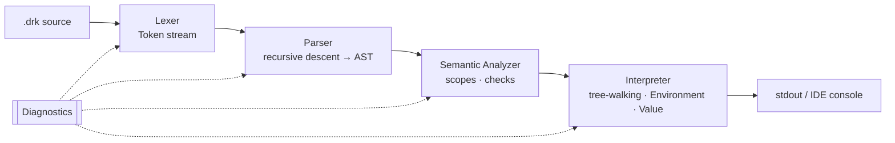

<div align="center">

# ⛰️ DORUK · Mert Studio Code v2

**A programming language with Turkish keywords: its own lexer, parser, semantic analyzer and
interpreter, plus a native Qt IDE and an Electron/Monaco editor**


[The language](#-the-language) · [Architecture](#-architecture) · [Build](#-build) · [Türkçe](#-türkçe)

</div>

---

**DORUK** ("summit" in Turkish) makes programming read like Turkish. Beginners can write
`eğer`, `döngü` and `yazdır` instead of `if`, `while` and `print`, while the engine underneath is a
conventional, fully hand-written language implementation in modern C++.
**Mert Studio Code** is the IDE built around it.

## 📝 The language

```js
// Fonksiyonlar, özyineleme
fonksiyon faktoriyel(n) {
    eğer (n <= 1) { döndür 1 }
    döndür n * faktoriyel(n - 1)
}

// Değişkenler, listeler, döngüler
değişken sayilar = [10, 20, 30, 40, 50]
için (değişken i = 0; i < 5; i += 1) {
    yazdır("  " + sayilar[i])
}

değişken sayac = 0
döngü (doğru) {
    eğer (sayac >= 3) { kır }
    sayac += 1
}

eğer (sayac == 3 ve faktoriyel(5) == 120) {
    yazdır("DORUK çalışıyor!")
} değilse {
    yazdır("Bir şeyler ters gitti")
}
```

| DORUK | Meaning | | DORUK | Meaning |
|---|---|---|---|---|
| `değişken` | variable declaration | | `fonksiyon` | function |
| `eğer` / `değilse` | if / else | | `döndür` | return |
| `döngü` | while loop | | `için` | for loop |
| `kır` | break | | `ve` / `veya` | and / or |
| `doğru` / `yanlış` | true / false | | `yazdır` | print |

A complete tour lives in [`doruk/ornek.drk`](doruk/ornek.drk).

## 🧩 Architecture



| Component | Location | Notes |
|---|---|---|
| **Engine** | `doruk/engine/` | `Lexer`, `Parser`, `AST`, `SemanticAnalyzer`, `Interpreter`, `Environment`, `Value`, `Diagnostics` (static library) |
| **CLI** | `doruk/cli/` | Runs `.drk` files from the terminal |
| **Qt IDE** | `doruk/ide/` | Code editor with syntax highlighting, minimap, themes, custom dialogs, and a background runner thread |
| **Electron IDE** | `doruk-ide/` | Lightweight Monaco-based editor with a DORUK language definition and themes |
| **Tests** | `doruk/tests/` | Catch2 suites for the lexer, parser and interpreter |

## 🚀 Build

Requirements: CMake 3.20+, a C++17 compiler (MSVC 2022, GCC 10+ or Clang 12+) and Qt 6 for the IDE.

```bash
cd doruk
cmake -B build -DCMAKE_BUILD_TYPE=Release
cmake --build build --config Release
ctest --test-dir build -C Release --output-on-failure
```

Electron editor:

```bash
cd doruk-ide
npm install
npm start
```

See [`doruk/BUILD.md`](doruk/BUILD.md) for Visual Studio and MSYS2 instructions.

## 🇹🇷 Türkçe

**DORUK**, Türkçe anahtar kelimelerle yazılan bir programlama dilidir. Lexer, parser,
anlamsal çözümleyici ve yorumlayıcı C++17 ile sıfırdan yazılmıştır. **Mert Studio Code** ise
bu dil için geliştirilen IDE'dir: Qt 6 ile yerel masaüstü sürümü (sözdizimi renklendirme, mini harita,
temalar) ve Electron + Monaco tabanlı hafif bir editör. Testler Catch2 ile yazılmıştır.
Dilin ilk, web tabanlı editörü için: [Mert-Studio-Code](https://github.com/Soap2647/Mert-Studio-Code).

---

<div align="center"><sub>Built by <a href="https://github.com/Soap2647">Mert Yasin Yılmaz</a></sub></div>
